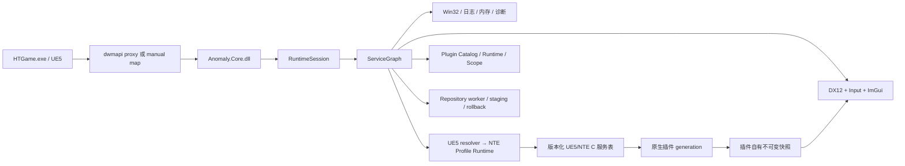
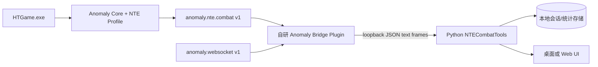

# Anomaly 项目分析

> 调研日期：2026-08-26（Asia/Shanghai）
> 调研对象：[`AnomalyNTE/Anomaly`](https://github.com/AnomalyNTE/Anomaly)
> 代码基线：[`0e1b59c02914e943a45885b40ee78ea1dcf8bd1e`](https://github.com/AnomalyNTE/Anomaly/tree/0e1b59c02914e943a45885b40ee78ea1dcf8bd1e)，也是正式版本 [`v1.7.0`](https://github.com/AnomalyNTE/Anomaly/releases/tag/v1.7.0)
> 来源范围：仅使用项目仓库 README、文档、源码、Manifest/CMake/CI 配置和 GitHub 官方 API。动态统计均为调研时快照。

## 结论先行

Anomaly 不是一个单用途的“战斗统计器”，而是一个注入《异环》（Neverness to Everness，NTE）进程的 **Windows x64 原生插件平台与 UE5/NTE 适配运行时**。它通过 `dwmapi.dll` 代理或启动器实时附加把 `Anomaly.Core.dll` 带入 `HTGame.exe`，在进程内提供生命周期、线程调度、Hook、D3D12/ImGui UI、插件包管理、诊断、UE5/NTE 语义服务和稳定的纯 C ABI v1。项目 README 将定位明确写为“面向研究、诊断与插件开发”，同时明确提示崩溃、数据损坏和封号风险。[来源：README](https://github.com/AnomalyNTE/Anomaly/blob/0e1b59c02914e943a45885b40ee78ea1dcf8bd1e/README.md)

对当前名为 `NTECombatTools` 的工作区，最重要的现成能力是 `anomaly.nte.combat` v1：它提供当前角色战斗快照、单调序列的角色伤害事件、按参与者/来源/方向聚合的统计，以及来源和参与者名称解析；仓库还附有完整的 `nte_combat_demo` 消费示例。[来源：NTE 服务 API](https://github.com/AnomalyNTE/Anomaly/blob/0e1b59c02914e943a45885b40ee78ea1dcf8bd1e/docs/api-reference/nte-services.md#anomalyntecombat) · [示例源码](https://github.com/AnomalyNTE/Anomaly/blob/0e1b59c02914e943a45885b40ee78ea1dcf8bd1e/examples/nte_combat_demo/plugin.cpp) · [示例 Manifest](https://github.com/AnomalyNTE/Anomaly/blob/0e1b59c02914e943a45885b40ee78ea1dcf8bd1e/examples/nte_combat_demo/manifest.json)

因此，若 `NTECombatTools` 计划做外部 Python 分析/UI，较合理的集成方式不是重新扫描游戏内存，而是编写一个很薄的 Anomaly 原生插件：在 Game 域读取 `anomaly.nte.combat`，规范化后通过 Anomaly 的本地 WebSocket 服务广播 JSON，Python 端只连接 `ws://127.0.0.1:14514`。这是基于现有 ABI 能力做出的架构建议，不是仓库已经提供的战斗 WebSocket 协议；WebSocket 服务只提供无语义的文本广播，协议仍需本项目自行定义。[来源：WebSocket API](https://github.com/AnomalyNTE/Anomaly/blob/0e1b59c02914e943a45885b40ee78ea1dcf8bd1e/docs/api-reference/websocket.md) · [战斗消费线程规则](https://github.com/AnomalyNTE/Anomaly/blob/0e1b59c02914e943a45885b40ee78ea1dcf8bd1e/docs/api-reference/nte-services.md#anomalyntecombat)

## 1. 项目定位与边界

- **产品形态**：面向 NTE 的原生插件宿主、SDK、安装/更新启动器和诊断工具集合；游戏内按 `Insert` 打开管理界面，可启停、重载、安装和更新插件。[来源：README 功能与快速上手](https://github.com/AnomalyNTE/Anomaly/blob/0e1b59c02914e943a45885b40ee78ea1dcf8bd1e/README.md#-%E5%8A%9F%E8%83%BD%E4%BB%8B%E7%BB%8D)
- **支持范围**：仅 Windows x64；生产构建使用 Visual Studio 2022/MSVC，核心语言标准为 C++20，插件公开边界为纯 C ABI v1。[来源：README 徽章与注意事项](https://github.com/AnomalyNTE/Anomaly/blob/0e1b59c02914e943a45885b40ee78ea1dcf8bd1e/README.md) · [CMakeLists](https://github.com/AnomalyNTE/Anomaly/blob/0e1b59c02914e943a45885b40ee78ea1dcf8bd1e/CMakeLists.txt) · [架构文档 ABI 边界](https://github.com/AnomalyNTE/Anomaly/blob/0e1b59c02914e943a45885b40ee78ea1dcf8bd1e/docs/developer-guide/architecture.md#abi-%E8%BE%B9%E7%95%8C)
- **接入游戏的方式**：首选把代理 `dwmapi.dll` 和 `Anomaly/` 目录安装到 `HTGame.exe` 旁；代理先加载系统原版 `dwmapi.dll` 并转发导出，再在独立线程加载 Core。启动器也支持从官方启动器创建新游戏进程后进行实时附加/manual map。[来源：安装文档](https://github.com/AnomalyNTE/Anomaly/blob/0e1b59c02914e943a45885b40ee78ea1dcf8bd1e/docs/user-guide/installation.md) · [代理入口源码](https://github.com/AnomalyNTE/Anomaly/blob/0e1b59c02914e943a45885b40ee78ea1dcf8bd1e/src/bootstrap/dwmapi/proxy_main.cpp) · [manual map 源码目录](https://github.com/AnomalyNTE/Anomaly/tree/0e1b59c02914e943a45885b40ee78ea1dcf8bd1e/src/launcher)
- **明确非目标/限制**：项目声明不得用于作弊，但其内建能力包含内存读写、Hook、Patch、瞬移、自动拾取及技能调用等会改变游戏状态的功能；“用途声明”并不能消除游戏运营方规则和技术检测带来的风险。[来源：README 风险提示](https://github.com/AnomalyNTE/Anomaly/blob/0e1b59c02914e943a45885b40ee78ea1dcf8bd1e/README.md#%EF%B8%8F-%E5%85%8D%E8%B4%A3%E5%A3%B0%E6%98%8E%E4%B8%8E%E9%A3%8E%E9%99%A9%E6%8F%90%E7%A4%BA) · [战斗 ABI 设计范围](https://github.com/AnomalyNTE/Anomaly/blob/0e1b59c02914e943a45885b40ee78ea1dcf8bd1e/docs/developer-guide/nte-combat-abi-plan.md)
- **许可证**：主项目为 `AGPL-3.0-only`；计划复制、修改、分发或通过网络提供派生服务前，需要单独评估许可证义务。第三方组件许可证单列在 `NOTICE` 与 `third_party/licenses/`。[来源：LICENSE](https://github.com/AnomalyNTE/Anomaly/blob/0e1b59c02914e943a45885b40ee78ea1dcf8bd1e/LICENSE) · [NOTICE](https://github.com/AnomalyNTE/Anomaly/blob/0e1b59c02914e943a45885b40ee78ea1dcf8bd1e/NOTICE)

## 2. 技术栈

| 层面 | 技术与用途 | 一手来源 |
| --- | --- | --- |
| 主语言/构建 | C++20 + 少量 C；CMake 3.22+；Visual Studio 2022 x64；PowerShell 7 脚本 | [CMakeLists](https://github.com/AnomalyNTE/Anomaly/blob/0e1b59c02914e943a45885b40ee78ea1dcf8bd1e/CMakeLists.txt) · [CMakePresets](https://github.com/AnomalyNTE/Anomaly/blob/0e1b59c02914e943a45885b40ee78ea1dcf8bd1e/CMakePresets.json) · [构建文档](https://github.com/AnomalyNTE/Anomaly/blob/0e1b59c02914e943a45885b40ee78ea1dcf8bd1e/docs/developer-guide/building.md) |
| 平台/渲染 | Win32、DXGI、Direct3D 12；另有 D3D11 嵌入式 fixture；Dear ImGui 游戏内 UI | [渲染源码目录](https://github.com/AnomalyNTE/Anomaly/tree/0e1b59c02914e943a45885b40ee78ea1dcf8bd1e/src/render) · [UI 源码目录](https://github.com/AnomalyNTE/Anomaly/tree/0e1b59c02914e943a45885b40ee78ea1dcf8bd1e/src/ui) · [CMakeLists](https://github.com/AnomalyNTE/Anomaly/blob/0e1b59c02914e943a45885b40ee78ea1dcf8bd1e/CMakeLists.txt) |
| Hook/内存 | MinHook、PE/模块/内存区域、字节签名扫描、owner-scoped HookManager | [NOTICE](https://github.com/AnomalyNTE/Anomaly/blob/0e1b59c02914e943a45885b40ee78ea1dcf8bd1e/NOTICE) · [Hook 源码](https://github.com/AnomalyNTE/Anomaly/tree/0e1b59c02914e943a45885b40ee78ea1dcf8bd1e/src/hook) · [平台源码](https://github.com/AnomalyNTE/Anomaly/tree/0e1b59c02914e943a45885b40ee78ea1dcf8bd1e/src/platform/windows) |
| 数据/包 | nlohmann/json、JSON Schema Validator、miniz；Manifest、Repository Index、ZIP staging/rollback | [依赖声明](https://github.com/AnomalyNTE/Anomaly/blob/0e1b59c02914e943a45885b40ee78ea1dcf8bd1e/CMakeLists.txt) · [Schema 目录](https://github.com/AnomalyNTE/Anomaly/tree/0e1b59c02914e943a45885b40ee78ea1dcf8bd1e/schemas) · [Repository 源码](https://github.com/AnomalyNTE/Anomaly/tree/0e1b59c02914e943a45885b40ee78ea1dcf8bd1e/src/repository) |
| 插件 ABI | 纯 C ABI v1、版本化服务表、`struct_size`/`service_version` 校验、C++ 轻量 wrapper | [SDK 头文件](https://github.com/AnomalyNTE/Anomaly/tree/0e1b59c02914e943a45885b40ee78ea1dcf8bd1e/include/anomaly/sdk) · [插件开发文档](https://github.com/AnomalyNTE/Anomaly/blob/0e1b59c02914e943a45885b40ee78ea1dcf8bd1e/docs/developer-guide/plugin-development.md) |
| 通信/诊断 | 本地命名管道诊断；Runtime 自有 WebSocket 广播服务，默认 `127.0.0.1:14514` | [诊断源码](https://github.com/AnomalyNTE/Anomaly/tree/0e1b59c02914e943a45885b40ee78ea1dcf8bd1e/src/diagnostics) · [WebSocket API](https://github.com/AnomalyNTE/Anomaly/blob/0e1b59c02914e943a45885b40ee78ea1dcf8bd1e/docs/api-reference/websocket.md) |
| 自动化 | GitHub Actions `windows-2022`，构建、安装暂存、tag 打包、provenance attestation 和 GitHub Release | [CI workflow](https://github.com/AnomalyNTE/Anomaly/blob/0e1b59c02914e943a45885b40ee78ea1dcf8bd1e/.github/workflows/windows.yml) |

仓库固定下载的主要依赖版本是 ImGui `1.91.9b`、MinHook `1.3.4`、nlohmann/json `3.11.3`、JSON schema validator `2.3.0`、miniz `3.0.2`；中文 UI 字体为 Noto Sans CJK SC `2.004`。[来源：CMakeLists FetchContent](https://github.com/AnomalyNTE/Anomaly/blob/0e1b59c02914e943a45885b40ee78ea1dcf8bd1e/CMakeLists.txt) · [NOTICE](https://github.com/AnomalyNTE/Anomaly/blob/0e1b59c02914e943a45885b40ee78ea1dcf8bd1e/NOTICE)

## 3. 目录结构与职责

```text
src/bootstrap/dwmapi/   dwmapi 代理、系统导出转发、Core 引导
src/runtime/            RuntimeSession、ServiceGraph、Dispatcher、停止传播
src/services/           结构化日志、可靠存储等游戏无关服务
src/platform/windows/   Win32 模块、内存、Pattern、WebSocket、配置
src/diagnostics/        命名管道、CLI 请求、抓包、崩溃和恢复
src/hook/               owner-scoped Hook 管理与 MinHook 后端
src/render/ + src/ui/   DX12/DXGI、输入、ImGui 和管理界面
src/plugin/             Manifest、依赖、权限、Scope、代际、热重载
src/repository/         在线索引、校验、下载、staging、原子更新/回滚
src/game/ue5/           通用 UE5 符号、反射、对象、网络和 tick 适配
src/game/nte/           NTE Profile、Feature Gate 和高层 NTE 服务
include/anomaly/sdk/    对外稳定 C ABI 与 C++ wrapper
plugins/                随仓库构建的内建/开发插件
examples/               独立 SDK 消费示例（含 nte_combat_demo）
profiles/nte/           当前 NTE 签名、布局、依赖和 validator Profile
schemas/                Manifest、Profile、Repository JSON Schema
apps/                   启动器、CLI、profile/plugin/ABI 工具与 fixtures
tools/                  构建发布、诊断、Profile 扫描脚本
docs/                   用户、开发者与 API 文档
```

此职责图来自项目架构文档，并与实际顶层目录和 CMake target 对应。[来源：架构文档“源码布局”](https://github.com/AnomalyNTE/Anomaly/blob/0e1b59c02914e943a45885b40ee78ea1dcf8bd1e/docs/developer-guide/architecture.md#%E6%BA%90%E7%A0%81%E5%B8%83%E5%B1%80) · [仓库树](https://github.com/AnomalyNTE/Anomaly/tree/0e1b59c02914e943a45885b40ee78ea1dcf8bd1e) · [CMakeLists](https://github.com/AnomalyNTE/Anomaly/blob/0e1b59c02914e943a45885b40ee78ea1dcf8bd1e/CMakeLists.txt)

## 4. 核心架构与数据流



[来源：项目架构组件模型](https://github.com/AnomalyNTE/Anomaly/blob/0e1b59c02914e943a45885b40ee78ea1dcf8bd1e/docs/developer-guide/architecture.md#%E7%BB%84%E4%BB%B6%E6%A8%A1%E5%9E%8B) · [Core 组合根](https://github.com/AnomalyNTE/Anomaly/blob/0e1b59c02914e943a45885b40ee78ea1dcf8bd1e/src/runtime/core_main.cpp)

关键设计点：

1. **单一进程级所有者**：`RuntimeSession` 持有 service graph 和 stop source；服务按依赖顺序启动、反序关闭。后续服务启动失败时，先前服务仍会被确定性清理。[来源：架构文档“所有权与生命周期”](https://github.com/AnomalyNTE/Anomaly/blob/0e1b59c02914e943a45885b40ee78ea1dcf8bd1e/docs/developer-guide/architecture.md#%E6%89%80%E6%9C%89%E6%9D%83%E4%B8%8E%E7%94%9F%E5%91%BD%E5%91%A8%E6%9C%9F) · [RuntimeSession 源码](https://github.com/AnomalyNTE/Anomaly/blob/0e1b59c02914e943a45885b40ee78ea1dcf8bd1e/src/runtime/runtime_session.cpp)
2. **线程域隔离**：Lifecycle 管状态转换，Game 读游戏对象，Render 只绘制，Worker 做 I/O/解析，Diagnostics 采只读快照。跨域工作经 Dispatcher 投递，插件回调不会在持有宿主全局锁时执行。[来源：架构文档“线程域”](https://github.com/AnomalyNTE/Anomaly/blob/0e1b59c02914e943a45885b40ee78ea1dcf8bd1e/docs/developer-guide/architecture.md#%E7%BA%BF%E7%A8%8B%E5%9F%9F)
3. **代际与资源账本**：每次插件加载形成 generation 和 `PluginScope`，所有 Hook、订阅、任务、UI、纹理、Patch、IPC 都登记；卸载先停止新回调、撤销资源、等待 in-flight lease，再卸载 DLL。超时的代际被隔离并保持映射，以避免跳回已卸载代码。[来源：架构文档“所有权与生命周期”](https://github.com/AnomalyNTE/Anomaly/blob/0e1b59c02914e943a45885b40ee78ea1dcf8bd1e/docs/developer-guide/architecture.md#%E6%89%80%E6%9C%89%E6%9D%83%E4%B8%8E%E7%94%9F%E5%91%BD%E5%91%A8%E6%9C%9F) · [PluginScope 源码](https://github.com/AnomalyNTE/Anomaly/blob/0e1b59c02914e943a45885b40ee78ea1dcf8bd1e/src/plugin/plugin_scope.cpp)
4. **Profile 驱动适配**：活动 NTE Profile 保存 `GWorld`、`FNamePool`、`GObjects`、`GameTick`、`ProcessEvent` 和伤害广播等签名，以及 UE/NTE 布局、Feature 依赖和 validator；签名或布局验证失败时，对应语义服务按功能降级，而不是继续使用未验证地址。[来源：当前 Profile](https://github.com/AnomalyNTE/Anomaly/blob/0e1b59c02914e943a45885b40ee78ea1dcf8bd1e/profiles/nte/nte-current.json) · [Profile 用户文档](https://github.com/AnomalyNTE/Anomaly/blob/0e1b59c02914e943a45885b40ee78ea1dcf8bd1e/docs/user-guide/nte-profiles.md)
5. **插件 ABI 与实现解耦**：DLL 边界不传 STL、异常、RTTI 或内部 C++ 类型；插件通过 `query_service` 获取独立版本化函数表，并用 capability 控制服务可见性。但 capability 不是安全沙箱，因为插件仍是与游戏同进程的 native DLL。[来源：架构文档“ABI 边界”](https://github.com/AnomalyNTE/Anomaly/blob/0e1b59c02914e943a45885b40ee78ea1dcf8bd1e/docs/developer-guide/architecture.md#abi-%E8%BE%B9%E7%95%8C) · [插件开发“Capability 与授权”](https://github.com/AnomalyNTE/Anomaly/blob/0e1b59c02914e943a45885b40ee78ea1dcf8bd1e/docs/developer-guide/plugin-development.md#6-capability-%E4%B8%8E%E6%8E%88%E6%9D%83)

### 战斗数据流

`nte.combat` 的实现基线采用经过 Profile 验证的 `AHTAbilityCharacter::CharacterOnDamaged` 原生广播。Hook 在 Game 侧从同一次回调取得实际伤害、攻击者、受击者与 `DamageGEDef` 来源，写入固定容量 ring 和 World 范围聚合；插件在 `on_update` 中用 cursor 增量消费并解析名称，再把结果转换成不可变展示/传输快照。它不把客户端飘字误称为服务端权威日志，也不推断广播没有携带的暴击、爆头或展示伤害字段。[来源：战斗 ABI 规划“范围/伤害入口/运行时所有权”](https://github.com/AnomalyNTE/Anomaly/blob/0e1b59c02914e943a45885b40ee78ea1dcf8bd1e/docs/developer-guide/nte-combat-abi-plan.md) · [正式 NTE combat API](https://github.com/AnomalyNTE/Anomaly/blob/0e1b59c02914e943a45885b40ee78ea1dcf8bd1e/docs/api-reference/nte-services.md#anomalyntecombat)

## 5. 构建、运行与发布

### 开发者构建

前置条件为 Windows 10/11 x64、VS 2022 C++ Build Tools、Windows SDK、CMake 3.22+ 和 PowerShell 7+。唯一受支持入口是：

```powershell
.\build.cmd
```

等价流程为：

```powershell
cmake --preset windows-vs2022
cmake --build --preset windows-relwithdebinfo --parallel
cmake --install .build\windows-vs2022 --config RelWithDebInfo `
  --prefix .build\windows-vs2022\game-package --component GameRuntime
```

构建工具位于 `.build/windows-vs2022/bin/RelWithDebInfo`，可部署运行包位于 `.build/windows-vs2022/game-package`。另有 `windows-asan` preset，但它不是默认发布路径。[来源：构建文档](https://github.com/AnomalyNTE/Anomaly/blob/0e1b59c02914e943a45885b40ee78ea1dcf8bd1e/docs/developer-guide/building.md) · [build.cmd](https://github.com/AnomalyNTE/Anomaly/blob/0e1b59c02914e943a45885b40ee78ea1dcf8bd1e/build.cmd) · [CMakePresets](https://github.com/AnomalyNTE/Anomaly/blob/0e1b59c02914e943a45885b40ee78ea1dcf8bd1e/CMakePresets.json)

### 普通用户运行

普通用户下载 `Anomaly-<版本>-runtime.zip`，完整解压并运行 `AnomalyLauncher.exe`，选择直接包含 `HTGame.exe` 的目录后安装；也可手动复制 `dwmapi.dll` 和整个 `Anomaly/` 目录。游戏启动后按 `Insert` 打开界面。启动器需要管理员权限写游戏目录，并与同样使用 `dwmapi.dll` 的 RE-UE4SS 冲突。[来源：安装文档](https://github.com/AnomalyNTE/Anomaly/blob/0e1b59c02914e943a45885b40ee78ea1dcf8bd1e/docs/user-guide/installation.md)

### 发布产物

发布脚本组装 Runtime、SDK、Tools、Symbols 四个 ZIP，以及 SHA-256、release manifest 和 SPDX 2.3 SBOM；tag workflow 对公开的 Runtime/SDK/Tools 三个 ZIP 生成 GitHub build provenance attestation 并发布 Release。[来源：构建文档“发布打包”](https://github.com/AnomalyNTE/Anomaly/blob/0e1b59c02914e943a45885b40ee78ea1dcf8bd1e/docs/developer-guide/building.md#%E5%8F%91%E5%B8%83%E6%89%93%E5%8C%85) · [打包脚本](https://github.com/AnomalyNTE/Anomaly/blob/0e1b59c02914e943a45885b40ee78ea1dcf8bd1e/tools/package_release.ps1) · [CI workflow](https://github.com/AnomalyNTE/Anomaly/blob/0e1b59c02914e943a45885b40ee78ea1dcf8bd1e/.github/workflows/windows.yml)

## 6. 主要功能

- 插件的启用、停用、重载、状态与设置管理；Manifest v2、SemVer、依赖/capability 检查、影子代际热重载、失败隔离和回滚。[来源：README](https://github.com/AnomalyNTE/Anomaly/blob/0e1b59c02914e943a45885b40ee78ea1dcf8bd1e/README.md) · [插件开发文档](https://github.com/AnomalyNTE/Anomaly/blob/0e1b59c02914e943a45885b40ee78ea1dcf8bd1e/docs/developer-guide/plugin-development.md)
- 第三方 HTTPS 插件源的浏览、安装、更新与卸载；包级校验、ZIP 路径限制、staging 和 rollback。[来源：第三方插件文档](https://github.com/AnomalyNTE/Anomaly/blob/0e1b59c02914e943a45885b40ee78ea1dcf8bd1e/docs/user-guide/third-party-plugins.md) · [Repository 源码](https://github.com/AnomalyNTE/Anomaly/tree/0e1b59c02914e943a45885b40ee78ea1dcf8bd1e/src/repository)
- UE5/NTE 高层服务：会话、玩家、传送、导航、实体、拾取、地图地标、战斗、技能与技能调用，并通过 Profile/validator 做细粒度可用性 Gate。[来源：NTE 服务 API](https://github.com/AnomalyNTE/Anomaly/blob/0e1b59c02914e943a45885b40ee78ea1dcf8bd1e/docs/api-reference/nte-services.md) · [当前 Profile](https://github.com/AnomalyNTE/Anomaly/blob/0e1b59c02914e943a45885b40ee78ea1dcf8bd1e/profiles/nte/nte-current.json)
- 内建/随仓库插件包括坐标、传送、附近拾取、Entity ESP、Pink Paw Heist ESP、Custom UID、Camera Tools、WalletCollector，以及开发者模式下的地标探针、地图生成点导出和 DLL Loader。根 README 的“六个内建插件”文字与当前详细文档/源码目录数量并不完全一致，应以具体发布包和 Manifest 为准。[来源：内建插件文档](https://github.com/AnomalyNTE/Anomaly/blob/0e1b59c02914e943a45885b40ee78ea1dcf8bd1e/docs/user-guide/built-in-plugins.md) · [plugins 目录](https://github.com/AnomalyNTE/Anomaly/tree/0e1b59c02914e943a45885b40ee78ea1dcf8bd1e/plugins) · [README 内建插件表](https://github.com/AnomalyNTE/Anomaly/blob/0e1b59c02914e943a45885b40ee78ea1dcf8bd1e/README.md#-%E5%86%85%E5%BB%BA%E6%8F%92%E4%BB%B6)
- 诊断工具包括 named-pipe CLI、离线 inspect、Profile 校验、插件包工具、ABI snapshot、无游戏 test host、render fixtures、崩溃协调和诊断包脚本。[来源：构建文档“命令行工具”](https://github.com/AnomalyNTE/Anomaly/blob/0e1b59c02914e943a45885b40ee78ea1dcf8bd1e/docs/developer-guide/building.md#%E5%91%BD%E4%BB%A4%E8%A1%8C%E5%B7%A5%E5%85%B7) · [apps 目录](https://github.com/AnomalyNTE/Anomaly/tree/0e1b59c02914e943a45885b40ee78ea1dcf8bd1e/apps) · [tools 目录](https://github.com/AnomalyNTE/Anomaly/tree/0e1b59c02914e943a45885b40ee78ea1dcf8bd1e/tools)

## 7. 成熟度判断

### 积极信号

- 调研时 GitHub API 显示仓库公开、未归档，默认分支 `main`；创建于 2026-07-29，最新代码推送于 2026-08-25。项目虽年轻但发布节奏活跃。[来源：GitHub Repository API](https://api.github.com/repos/AnomalyNTE/Anomaly)
- 已有 14 个正式 Release（`v1.0.0` 至 `v1.7.0`），最新 `v1.7.0` 在 2026-08-25 发布且含 Runtime/SDK/Tools 三个资产。[来源：GitHub Releases API](https://api.github.com/repos/AnomalyNTE/Anomaly/releases?per_page=100) · [v1.7.0 Release](https://github.com/AnomalyNTE/Anomaly/releases/tag/v1.7.0)
- 最新 tag workflow 成功，发布流程包含依赖固定、校验和、SBOM 与 provenance attestation，供应链可追溯性设计比一般个人游戏工具完善。[来源：最新 Actions run](https://github.com/AnomalyNTE/Anomaly/actions/runs/32847587638) · [CI workflow](https://github.com/AnomalyNTE/Anomaly/blob/0e1b59c02914e943a45885b40ee78ea1dcf8bd1e/.github/workflows/windows.yml) · [打包脚本](https://github.com/AnomalyNTE/Anomaly/blob/0e1b59c02914e943a45885b40ee78ea1dcf8bd1e/tools/package_release.ps1)
- 架构文档对所有权、线程亲和性、代际、失败回滚和 ABI 边界有明确约束；公开 SDK 同时提供 ABI snapshot 基线和 C/C++ 示例。[来源：架构文档](https://github.com/AnomalyNTE/Anomaly/blob/0e1b59c02914e943a45885b40ee78ea1dcf8bd1e/docs/developer-guide/architecture.md) · [ABI 基线](https://github.com/AnomalyNTE/Anomaly/tree/0e1b59c02914e943a45885b40ee78ea1dcf8bd1e/abi) · [examples](https://github.com/AnomalyNTE/Anomaly/tree/0e1b59c02914e943a45885b40ee78ea1dcf8bd1e/examples)

### 保守信号与风险

| 风险 | 判断 | 证据 |
| --- | --- | --- |
| 项目年龄与维护集中度 | 截至调研日仓库不足一个月。GitHub contributors API 仅列 3 个账号，贡献高度集中于前两位；属于快速演进、关键人员集中阶段，不宜把 ABI v1 之外的内部实现当稳定合同。 | [Repository API](https://api.github.com/repos/AnomalyNTE/Anomaly) · [Contributors API](https://api.github.com/repos/AnomalyNTE/Anomaly/contributors?per_page=100) |
| 自动化测试门禁 | 仓库提供多个 fixture/test-host/ABI 工具，但当前 `CMakeLists.txt` 未注册 `add_test`/CTest，`windows.yml` 也只做 configure、build、install/package，没有执行这些验证程序。因此“能编译/能打包”不等同于行为回归已自动覆盖。 | [CMakeLists](https://github.com/AnomalyNTE/Anomaly/blob/0e1b59c02914e943a45885b40ee78ea1dcf8bd1e/CMakeLists.txt) · [CI workflow](https://github.com/AnomalyNTE/Anomaly/blob/0e1b59c02914e943a45885b40ee78ea1dcf8bd1e/.github/workflows/windows.yml) |
| 游戏版本脆弱性 | UE/NTE 能力依赖字节签名、偏移、反射形状与 vtable；游戏更新可能使 Profile 不再通过，导致服务不可用。框架设计了 validator 与降级，但不能消除更新维护成本。 | [当前 Profile](https://github.com/AnomalyNTE/Anomaly/blob/0e1b59c02914e943a45885b40ee78ea1dcf8bd1e/profiles/nte/nte-current.json) · [Profile 文档](https://github.com/AnomalyNTE/Anomaly/blob/0e1b59c02914e943a45885b40ee78ea1dcf8bd1e/docs/user-guide/nte-profiles.md) |
| 账号/稳定性/合规 | 工具进入游戏进程并可读写内存、Hook、Patch；官方公平游戏规则可能把瞬移、自动拾取、修改数据等视为违规。风险包括崩溃、数据损坏、封号。 | [README 风险提示](https://github.com/AnomalyNTE/Anomaly/blob/0e1b59c02914e943a45885b40ee78ea1dcf8bd1e/README.md#%EF%B8%8F-%E5%85%8D%E8%B4%A3%E5%A3%B0%E6%98%8E%E4%B8%8E%E9%A3%8E%E9%99%A9%E6%8F%90%E7%A4%BA) |
| 第三方插件供应链 | 插件是游戏进程内的原生 DLL，不是沙箱脚本；插件列表和包目前没有发布者签名。HTTPS、hash、Manifest 与路径校验只能保证传输/结构，不能证明代码可信。 | [README 第三方插件警告](https://github.com/AnomalyNTE/Anomaly/blob/0e1b59c02914e943a45885b40ee78ea1dcf8bd1e/README.md#-%E7%AC%AC%E4%B8%89%E6%96%B9%E6%8F%92%E4%BB%B6) · [第三方插件文档](https://github.com/AnomalyNTE/Anomaly/blob/0e1b59c02914e943a45885b40ee78ea1dcf8bd1e/docs/user-guide/third-party-plugins.md) |
| 本地接口安全边界 | WebSocket 只绑定 loopback 是好事，但没有定义鉴权或入站应用协议；任何本机进程都可连接接收广播。若战斗数据含玩家/对象路径，仍需最小化字段与日志脱敏。 | [WebSocket API](https://github.com/AnomalyNTE/Anomaly/blob/0e1b59c02914e943a45885b40ee78ea1dcf8bd1e/docs/api-reference/websocket.md) · [README 敏感信息提示](https://github.com/AnomalyNTE/Anomaly/blob/0e1b59c02914e943a45885b40ee78ea1dcf8bd1e/README.md#%EF%B8%8F-%E5%85%8D%E8%B4%A3%E5%A3%B0%E6%98%8E%E4%B8%8E%E9%A3%8E%E9%99%A9%E6%8F%90%E7%A4%BA) |
| 文档/发布包漂移 | 根 README、构建文档和内建插件详页对“六个内建插件”的描述与当前源码中更多插件/开发插件并不完全对齐。集成与审计应看目标 Release ZIP 的 Manifest，而非只看概览表。 | [README](https://github.com/AnomalyNTE/Anomaly/blob/0e1b59c02914e943a45885b40ee78ea1dcf8bd1e/README.md) · [构建文档](https://github.com/AnomalyNTE/Anomaly/blob/0e1b59c02914e943a45885b40ee78ea1dcf8bd1e/docs/developer-guide/building.md) · [内建插件文档](https://github.com/AnomalyNTE/Anomaly/blob/0e1b59c02914e943a45885b40ee78ea1dcf8bd1e/docs/user-guide/built-in-plugins.md) |

综合判断：**工程设计成熟度中等偏高，生态与运行验证成熟度仍早期**。换言之，代码组织、ABI、安全降级和发布供应链已有较系统的设计，但项目时间短、维护集中、与游戏版本强耦合，且 CI 尚未把独立验证程序变成自动门禁。适合用作实验性/研究型底座，不应在缺少版本锁定、降级路径和数据校验的情况下当作稳定生产依赖。

## 8. 与当前 `NTECombatTools` 工作区的关系

### 本地只读检查结果

调研开始时 `C:\Project\PythonProject\NTECombatTools` 是空目录，且不是 Git 仓库：未发现 `README`、`pyproject.toml`、`requirements*.txt`、`package.json`、源码、docs/notes 约定或任何可用于比对的实现。因此，目前只能依据工作区名称推断目标可能与 NTE 战斗采集/分析有关，不能声称已有代码与 Anomaly 兼容，也不能判断具体 Python 框架或数据模型。本报告因无既有约定，按任务约定写入 `docs/research/anomaly-project-analysis.md`。

### 可复用的最小能力面

对“战斗工具”最直接的服务是：

| 能力 | Anomaly 已提供 | 对本工作区的价值 |
| --- | --- | --- |
| 角色状态 | 当前角色、目标、HP、最大 HP、护盾、死亡/partial/stale 标记 | 避免 Python 直接持有 UE 指针 |
| 伤害流 | 单调 `sequence`、world、attacker、victim、source id、`final_damage`、事件 flags | 可形成事件表、DPS 时间线和会话聚合 |
| 聚合 | 按 world、character、source、攻击/受击方向过滤；提供 hit count 与伤害总量 | 直接生成技能/来源/参与者统计 |
| 名称解析 | source name、attacker/victim 对象路径的缓存解析 | 生成可读标签且不在 UI 线程读 UObject |
| 技能目录 | 已授予技能分页、level/input/active/cooldown（可能 partial） | 可做技能状态展示；不应与伤害来源强行等同 |
| 本地传输 | Runtime WebSocket UTF-8 文本广播，默认 loopback `14514` | 可桥接到 Python/浏览器，但需自定义 JSON schema |

[来源：NTE combat/skills API](https://github.com/AnomalyNTE/Anomaly/blob/0e1b59c02914e943a45885b40ee78ea1dcf8bd1e/docs/api-reference/nte-services.md#anomalyntecombat) · [WebSocket API](https://github.com/AnomalyNTE/Anomaly/blob/0e1b59c02914e943a45885b40ee78ea1dcf8bd1e/docs/api-reference/websocket.md)

### 推荐集成形态



桥接插件应在 `on_update`（Game 域）执行以下最小工作：比较 `latest_damage_sequence`、有界推进 `next_damage_event` cursor、只对新事件解析 source/participant、生成不含裸地址的版本化 JSON，再调用 `publish_text` 入队；Python 端负责持久化、聚合和 UI。不要在 `on_draw` 推进 cursor，也不要把 `NOT_FOUND` 一律解释为“无新事件”——若 latest 大于 cursor 而 next 仍取不到，说明 ring 窗口已越界，应从 0 重建 cursor。[来源：NTE combat 消费合同](https://github.com/AnomalyNTE/Anomaly/blob/0e1b59c02914e943a45885b40ee78ea1dcf8bd1e/docs/api-reference/nte-services.md#anomalyntecombat) · [参考消费者](https://github.com/AnomalyNTE/Anomaly/blob/0e1b59c02914e943a45885b40ee78ea1dcf8bd1e/examples/nte_combat_demo/plugin.cpp)

建议第一版桥接 Manifest 只申请 `nte-combat-read` 与 `websocket`，把两项服务都视为可降级依赖；除非产品需求非常明确，不申请 `memory-read`、`memory-write` 或 `nte-skill-invocation`。Capability 只能表达宿主授权范围，不能把原生 DLL 变成沙箱，因此桥接插件本身仍需保持小、可审计、依赖少。[来源：Manifest/capability API](https://github.com/AnomalyNTE/Anomaly/blob/0e1b59c02914e943a45885b40ee78ea1dcf8bd1e/docs/api-reference/manifest-and-capabilities.md) · [插件开发文档](https://github.com/AnomalyNTE/Anomaly/blob/0e1b59c02914e943a45885b40ee78ea1dcf8bd1e/docs/developer-guide/plugin-development.md#6-capability-%E4%B8%8E%E6%8E%88%E6%9D%83)

### 集成时必须明确的数据语义

- `final_damage` 来自角色原生伤害广播；不要把它宣传为服务端权威战斗日志。[来源：战斗 ABI 规划](https://github.com/AnomalyNTE/Anomaly/blob/0e1b59c02914e943a45885b40ee78ea1dcf8bd1e/docs/developer-guide/nte-combat-abi-plan.md)
- Ring 可能覆盖，解析也可能丢弃；统计的 `PARTIAL`/`OVERFLOW` 标志必须透传到 Python 数据质量状态。[来源：NTE combat API](https://github.com/AnomalyNTE/Anomaly/blob/0e1b59c02914e943a45885b40ee78ea1dcf8bd1e/docs/api-reference/nte-services.md#anomalyntecombat)
- World 切换、Host 重启或 Profile generation 变化会形成序列不连续/旧 handle 失效；数据库主键不能只用事件 `sequence`，至少应加入本地 session UUID、runtime version 和 world generation。[来源：NTE combat API](https://github.com/AnomalyNTE/Anomaly/blob/0e1b59c02914e943a45885b40ee78ea1dcf8bd1e/docs/api-reference/nte-services.md#anomalyntecombat)
- Profile 不可用时应明确显示“采集不可用/数据不完整”，不能用 0 伤害或空列表伪装成功。[来源：Profile 文档](https://github.com/AnomalyNTE/Anomaly/blob/0e1b59c02914e943a45885b40ee78ea1dcf8bd1e/docs/user-guide/nte-profiles.md)
- 对象路径、日志和诊断包可能泄露玩家或本机信息；JSON 协议应默认不发送裸地址、文件路径和无必要对象全路径。[来源：README 敏感信息提示](https://github.com/AnomalyNTE/Anomaly/blob/0e1b59c02914e943a45885b40ee78ea1dcf8bd1e/README.md#%EF%B8%8F-%E5%85%8D%E8%B4%A3%E5%A3%B0%E6%98%8E%E4%B8%8E%E9%A3%8E%E9%99%A9%E6%8F%90%E7%A4%BA)

## 9. 建议的下一步（不属于本次调研实施范围）

1. 先定义 `NTECombatTools` 自己的只读事件协议，例如 `schemaVersion`、`sessionId`、`runtimeVersion`、`worldGeneration`、`sequence`、`attacker`、`victim`、`source`、`finalDamage`、`qualityFlags`。
2. 以 `examples/nte_combat_demo` 为消费逻辑基线、以插件模板为工程基线，实现最小 bridge；不要复制 Runtime 内部头文件或直接读取游戏内存。[来源：战斗示例](https://github.com/AnomalyNTE/Anomaly/tree/0e1b59c02914e943a45885b40ee78ea1dcf8bd1e/examples/nte_combat_demo) · [官方插件模板](https://github.com/AnomalyNTE/Anomaly-Plugin-Template)
3. Python 端先做断线重连、重复序列去重、cursor gap/`PARTIAL` 可视化和原始事件落盘，再做 DPS 等派生指标。
4. 固定依赖到明确的 Anomaly Release/SDK，不跟随 `main` 内部实现；升级时先跑无游戏 test host/ABI 检查，再安排自有测试环境的真实 NTE smoke。[来源：构建与工具文档](https://github.com/AnomalyNTE/Anomaly/blob/0e1b59c02914e943a45885b40ee78ea1dcf8bd1e/docs/developer-guide/building.md) · [SDK ABI 基线](https://github.com/AnomalyNTE/Anomaly/tree/0e1b59c02914e943a45885b40ee78ea1dcf8bd1e/abi)
5. 在任何真实账号使用前单独确认游戏规则、账号风险、分发方式和 AGPL 合规；这不是单纯的技术集成问题。[来源：README 风险与许可](https://github.com/AnomalyNTE/Anomaly/blob/0e1b59c02914e943a45885b40ee78ea1dcf8bd1e/README.md)

## 10. 来源索引

- [仓库 README（定位、功能、风险、许可、快速上手）](https://github.com/AnomalyNTE/Anomaly/blob/0e1b59c02914e943a45885b40ee78ea1dcf8bd1e/README.md)
- [架构概览](https://github.com/AnomalyNTE/Anomaly/blob/0e1b59c02914e943a45885b40ee78ea1dcf8bd1e/docs/developer-guide/architecture.md)
- [从源码构建](https://github.com/AnomalyNTE/Anomaly/blob/0e1b59c02914e943a45885b40ee78ea1dcf8bd1e/docs/developer-guide/building.md)
- [插件开发](https://github.com/AnomalyNTE/Anomaly/blob/0e1b59c02914e943a45885b40ee78ea1dcf8bd1e/docs/developer-guide/plugin-development.md)
- [NTE 服务 API](https://github.com/AnomalyNTE/Anomaly/blob/0e1b59c02914e943a45885b40ee78ea1dcf8bd1e/docs/api-reference/nte-services.md)
- [WebSocket API](https://github.com/AnomalyNTE/Anomaly/blob/0e1b59c02914e943a45885b40ee78ea1dcf8bd1e/docs/api-reference/websocket.md)
- [NTE 战斗 ABI 规划与证据](https://github.com/AnomalyNTE/Anomaly/blob/0e1b59c02914e943a45885b40ee78ea1dcf8bd1e/docs/developer-guide/nte-combat-abi-plan.md)
- [当前 NTE Profile](https://github.com/AnomalyNTE/Anomaly/blob/0e1b59c02914e943a45885b40ee78ea1dcf8bd1e/profiles/nte/nte-current.json)
- [CMakeLists](https://github.com/AnomalyNTE/Anomaly/blob/0e1b59c02914e943a45885b40ee78ea1dcf8bd1e/CMakeLists.txt) / [CMakePresets](https://github.com/AnomalyNTE/Anomaly/blob/0e1b59c02914e943a45885b40ee78ea1dcf8bd1e/CMakePresets.json) / [Windows CI](https://github.com/AnomalyNTE/Anomaly/blob/0e1b59c02914e943a45885b40ee78ea1dcf8bd1e/.github/workflows/windows.yml)
- [GitHub Repository API](https://api.github.com/repos/AnomalyNTE/Anomaly) / [Releases API](https://api.github.com/repos/AnomalyNTE/Anomaly/releases?per_page=10) / [Contributors API](https://api.github.com/repos/AnomalyNTE/Anomaly/contributors?per_page=100)
